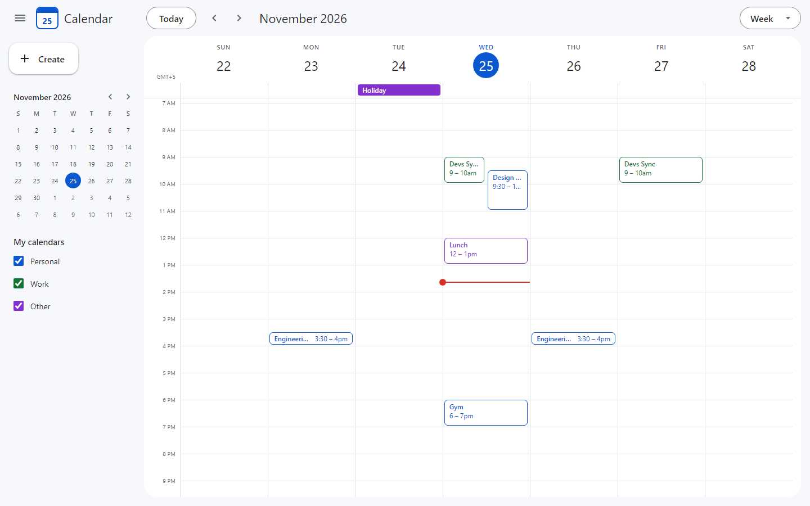
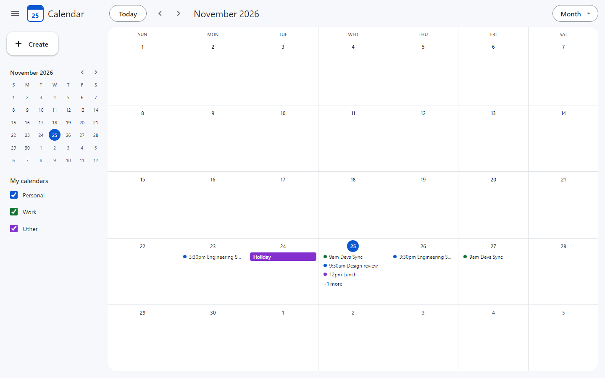
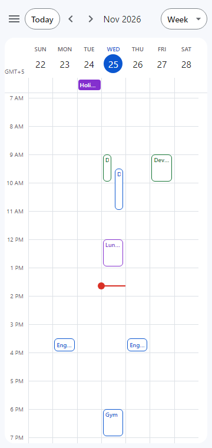

# Calendar App

A simple calendar that runs in your web browser, with a week view and a month view. It is for anyone who wants to keep track of events without signing up or installing anything.



| Month view | Phone |
|---|---|
|  |  |

## Features
- Add, edit and delete events, each with a title, date, start and end time, and description.
- See your events by **Week** (an hourly grid) or by **Month**. In the week view, a red line shows the current time.
- Sort events into three calendars, **Personal**, **Work** and **Other**, each with its own colour.
- Show or hide each calendar with a checkbox under **My calendars**.
- Jump to any date with the small month calendar in the sidebar.
- Click a date number to see every event on that day.
- Use it on a phone, tablet or computer. The layout changes for smaller screens.
- Your events are saved in your browser, so they are still there after you close the page.

## Setup
1. Get the project. Choose one of these:
   - **Download ZIP:** go to https://github.com/AreejBatool/calendar-app, click the green **Code** button, then click **Download ZIP**. Unzip (extract) the file you downloaded.
   - **Clone with git** (git is a tool for copying code projects). Type this in a terminal:
     ```sh
     git clone https://github.com/AreejBatool/calendar-app.git
     ```
2. Open the project folder.
3. Double-click `index.html`. It opens in your web browser and the calendar appears.

You do not need to install anything. There is no server and no setup beyond these steps.

## How to use
**Add an event**
1. Click **Create** in the sidebar. You can also click an empty hour in the week view, or an empty day in the month view, to start with that date (and hour) filled in.
2. Fill in **Title** and **Date** (both required). **Start**, **End**, **Calendar** and **Description** are optional.
3. Click **Save**.

**Edit or delete an event**
1. Click the event in the calendar. The **Edit event** form opens.
2. Change what you need and click **Save**, or click **Delete** and confirm.

**Switch between views**
- Use the **Week** / **Month** drop-down in the top right. The app remembers your choice.

**Move between weeks or months**
- Click the left and right arrows next to **Today** to go back or forward.
- Click **Today** to return to the current date.
- Or click any date in the small calendar in the sidebar.

**Show or hide calendars**
- Under **My calendars**, untick a box to hide those events. Tick it again to show them.
- Click the menu button (three lines, top left) to show or hide the sidebar.

## Example usage
Add a "Team meeting" this Friday from 9:00 to 10:00:

1. Click **Create**. A form titled **Add event** opens.
2. Type `Team meeting` in **Title**.
3. In **Date**, pick this Friday.
4. Set **Start** to 9:00 AM and **End** to 10:00 AM.
5. In **Calendar**, choose **Work**.
6. Click **Save**. The form closes. In the week view, a green block showing "Team meeting" and "9 – 10am" appears in Friday's column.

If you leave **Title** empty, or set **End** before **Start**, you see a red message under the field and the event is not saved until you fix it.

The app saves the event in localStorage (storage inside your browser) under the name `calendarEvents`. It looks like this:

```json
{
  "id": "lq3k9x2abcd",
  "title": "Team meeting",
  "date": "2026-11-27",
  "calendar": "work",
  "startTime": "09:00",
  "endTime": "10:00",
  "description": ""
}
```

The `id` is created automatically. Times use the 24-hour clock. An event with no start time is shown as an all-day event.

## Tips
- Your events are stored only in this browser on this computer. A different browser or device will not see them, and clearing your browser data deletes them.
- To reset all data: open your browser's developer tools (press F12), go to the **Console** tab, paste this line and press Enter:
  ```js
  ['calendarEvents', 'calendarView', 'calendarHidden'].forEach((k) => localStorage.removeItem(k)); location.reload();
  ```
- Keyboard shortcuts: press **Esc** to close the open form or pop-up. Use **Tab** to move between buttons and **Enter** to press one.
- When a date number has keyboard focus, the left and right arrow keys move one day. In the month view, the up and down arrow keys move one week. The small calendar in the sidebar works the same way: up and down move one week there too.
- Using only the keyboard? The first **Tab** on the page shows a **Skip to calendar** link. Press **Enter** to jump straight to the calendar.
- The month view shows up to 3 events per day. Click **+N more** to see the rest.

## Changing the styles (Tailwind CSS)
The look is built with [Tailwind CSS](https://tailwindcss.com) v4. You only need this section if you want to change colours or layout. To just use the app, skip it.

1. Install [Node.js](https://nodejs.org) (version 20 or newer).
2. In the project folder, run `npm install` once.
3. Edit `src/input.css` (colours, shared styles) or the Tailwind classes in `index.html`.
4. Run `npm run build:css` to rebuild `styles.css`. While you work, `npm run watch:css` rebuilds it every time you save.

- Colours live in the `@theme` block at the top of `src/input.css`, for example `--color-accent`. Changing one value there updates every place that uses it.
- `phone:`, `tablet:` and `tiny:` in class names mean "at 600px wide or less", "at 900px or less" and "at 380px or less".
- Commit the rebuilt `styles.css`. The live site serves that file as it is, with no build step.

## Project files
| File | What it does |
|---|---|
| `index.html` | The page itself: top bar, sidebar, calendar area and the event forms. |
| `styles.css` | The look and layout. It is generated from `src/input.css`, so don't edit it by hand. |
| `src/input.css` | The Tailwind source: colour tokens, shared styles, and the tablet and phone rules. |
| `package.json` | The Tailwind build commands (`build:css`, `watch:css`). |
| `app.js` | Everything the app does: saving, showing events, views, forms and checks. |
| `docs/` | The screenshots shown in this README. |
| `tasks/todo.md` | The task plan and review notes. |
| `.claude/` | Settings for the Claude Code assistant. Not needed to run the app. |
